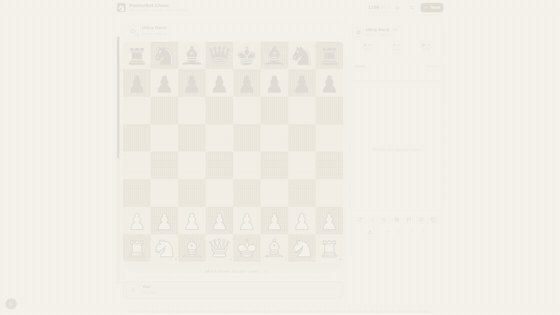

<div align="center">

# ♞ ChessMind Local

**A complete, 100% offline chess game with a real built-in AI engine — no servers, no accounts, no API keys, no telemetry. Ever.**

Play against **ChessMind** (4 difficulty levels, ~800–2500 Elo) or pass & play a friend on one device. Works on **Windows, macOS, Linux, Android, iOS, and any browser** — from a single codebase.

[](LICENSE)
[](https://github.com/your-username/chessmind-local/releases)
[](https://nextjs.org)
[](https://github.com/your-username/chessmind-local/tree/main/src/lib/chess)

</div>

---

## 🎬 See It In Action

<p align="center">
  
  <br/>
  <em>Real gameplay: AI thinking, eval bar, move classification, adaptive learning, PGN export</em>
</p>

---

## 📥 Install in Seconds — Pick Your Platform

| Platform | Download | How to Install |
|----------|----------|----------------|
| **Windows** | `ChessMind-Local-Setup-x.x.x-x64.exe` | **Double-click → Done.** Installs itself, creates Desktop + Start Menu shortcuts. |
| **macOS (Apple Silicon)** | `ChessMind-Local-x.x.x-arm64.dmg` | Open → Drag to Applications. First launch: right-click → Open (unsigned). |
| **macOS (Intel)** | `ChessMind-Local-x.x.x-x64.dmg` | Same as above. |
| **Linux** | `ChessMind-Local-x.x.x-x86_64.AppImage` or `...amd64.deb` | AppImage: `chmod +x` → double-click. Deb: `sudo apt install ./ChessMind-Local-*.deb`. |
| **Android** | `ChessMind-Local-x.x.x.apk` | Open file → Allow "Install unknown apps" → **Icon lands on home screen**. Fully offline. |
| **iPhone / iPad** | Install the web app | Open hosted version in Safari → Share → **Add to Home Screen** → Full-screen, offline. |
| **Any Browser** | [Play Online](https://your-username.github.io/chessmind-local) | No install needed. Works offline after first load (PWA). |

> **All installers are built automatically on every release via GitHub Actions.** Go to [Releases](../../releases) for the latest files.

---

## ♟️ What Makes ChessMind Local Special

### 🧠 A Real Chess Engine, Written From Scratch
Not a Stockfish wrapper. ~2,600 lines of pure TypeScript implementing:
- **Alpha-beta search** with iterative deepening, quiescence, transposition tables (1M entries, Zobrist hashing), killer moves, history heuristic
- **Hand-crafted evaluation** (PeSTO-style tables): tapered midgame/endgame, pawn structure, passed pawns, king safety, bishop pair, rook open files, mobility
- **Large opening book** (~200+ main lines: Sicilian, Ruy Lopez, French, Italian, Queen's Gambit, London, Caro-Kann...)
- **Runs in a Web Worker** — UI **never stutters**, even while AI thinks at depth 14+

### 🎯 4 Honest Difficulty Levels

| Level | Est. Elo | Depth | Time/Move | Temperature | Book Depth |
|-------|----------|-------|-----------|-------------|------------|
| 😊 **Easy** | ~800 | 2 | 0.3s | 140 (probabilistic) | 2 plies |
| ⚔️ **Medium** | ~1400 | 3 | 0.7s | 30 | 6 plies |
| 🔥 **Ultra Hard** | ~2000 | 8 | 0.85s | 0 (always best) | 12 plies |
| 👑 **Master** | ~2500 | 14 | 1.3s | 0 (always best) | 16 plies |

**No fake "handicaps"**. Easy plays *probabilistically* (softmax over root moves) — it makes human-like mistakes. Ultra Hard & Master play the **objectively strongest move** found — zero deliberate errors.

### 🤝 Pass & Play — Two Players, One Device
- Player names (remembered)
- Per-player clocks with auto board flip after every move
- No rating changes — pure friendly games

### 🧠 Live Coach & Move Classification
- **On-demand hints** with guaranteed fallback chain
- **Per-move classification**: Book / Best / Excellent / Inaccuracy / Mistake / Blunder
- **Accuracy scores** per game & per player
- **Eval bar** (side) + **Eval graph** (full game line chart)
- Opening name detection (Ruy Lopez, Sicilian, etc.)

### ⏱️ Tournament-Grade Clocks
- Unlimited, 3+2 Blitz, 5 min Blitz, 10 min Rapid, 15+10 Classical
- Visual warning <30s (red clock)
- Time expiry = loss

### 📜 Full Rules Implementation
Castling, en passant, promotion (with picker), threefold repetition, 50-move rule, stalemate, insufficient material — all verified.

### 📊 Ratings & Statistics
- Local Elo rating (vs AI only)
- Streaks, peak rating, win rate
- Per-level records (e.g., "vs Ultra Hard: 3W 1L")
- Game archive (last 50 games) with **PGN export** (copy or `.pgn` download)

### 🎓 Adaptive Learning — The AI *Remembers You*
VS-AI games build a persistent profile:
- **Player Model** (EWMA): aggression, blunder rate, mistake rate, accuracy, avg move time, opening preferences
- **Memory Book**: lines that beat you → avoided; lines that lost you games → repeated
- **Live Style Bias**: shaky play → AI sharpens; solid play → AI squeezes quietly
- **Insights Feed**: real-time messages like *"You've captured 5 times in 10 moves — I'm keeping the position closed."*
- **Wipe anytime** (Settings → Wipe AI Memory) — rating & games stay safe

### 🎨 Themes & Polish
- 6 board themes: Walnut, Tournament Green, Slate & Stone, Midnight Neon, Coral Beach, Cherry Wood
- Piece animations (0–400ms slider)
- Sound effects (WebAudio — zero audio files)
- Legal-move dots, coordinates, last-move highlight, eval bar — all toggleable
- Dark/light mode (system + manual)

### 🔒 100% Offline — Privacy by Architecture
| Guarantee | How It's Enforced |
|-----------|-------------------|
| **No network calls** | Zero `fetch`/`XMLHttpRequest`/WebSocket in app code |
| **No analytics** | No Google Analytics, Mixpanel, Sentry, nothing |
| **No third-party scripts** | All JS/CSS bundled locally; fonts self-hosted |
| **No accounts** | No auth, no email, no cloud sync |
| **Data stays on device** | 6 `localStorage` keys (~KB total): settings, profile, games, AI memory |
| **Desktop/Android apps** | Wrap the *exact same static files* — no extra permissions |

**Pull the ethernet cable — everything keeps working.**

---

## 🏗️ Architecture — How It Works

```
src/                          ← Entire app (Next.js 16, React 19, TypeScript)
├─ app/                       ← App shell (page.tsx = main entry)
├─ components/chess/          ← Game UI: board, pieces, panels, dialogs
├─ components/ui/             ← shadcn/ui primitives (35+ components)
├─ hooks/use-chess-game.ts    ← ⭐ Game brain (1300 lines): state, AI coordination
└─ lib/chess/                 ← ⭐ CHESS ENGINE (AI core):
   ├─ board.ts                ← 0x88 board, move gen, FEN, make/undo
   ├─ search.ts               ← Alpha-beta + quiescence + TT + killers
   ├─ eval.ts                 ← Tapered PeSTO evaluation
   ├─ book.ts                 ← Opening book (weighted random)
   ├─ learning.ts             ← Adaptive learning (player model + memory)
   ├─ engine.ts               ← Facade: levels, book+search+learning
   └─ worker-entry.ts         ← Web Worker message handler

public/
├─ chess-worker.js            ← Compiled engine worker (bun run worker)
├─ manifest.json              ← PWA manifest
├─ sw.js                      ← Service worker (offline)
└─ pieces/                    ← cburnett SVG piece set

electron/                     ← Desktop wrapper (main.cjs)
android/                      ← Capacitor Android project (after sync)
.github/workflows/            ← CI + multi-platform auto-releases
scripts/                      ← Engine tests: perft, test-engine, test-book, test-learning
```

### Data Flow: Click → AI Reply (0.3–1.3s)
```
1. Click square → board.tsx detects legal targets
2. page.tsx → useChessGame.tryMove()
3. Legal? → Update position, play sound, classify move (coach)
4. AI's turn? → worker.postMessage({type:"search", fen, level...})
5. Web Worker: book check → iterative deepening search → learning bias
6. Worker → postMessage({bestMove, score, depth, nodes, pv})
7. useChessGame applies AI move, updates learning, checks game end
8. React re-renders: board, move list, eval bar, graph, engine panel
```

---

## 🛠️ Build From Source (2 Minutes)

### Prerequisites
- **Bun** (recommended): `curl -fsSL https://bun.sh/install | bash`
- **Node.js 20+** (for Electron/Capacitor)
- **Git**

### Commands
```bash
# 1. Clone & install
git clone https://github.com/your-username/chessmind-local.git
cd chessmind-local
bun install                    # ~1 minute

# 2. Develop (hot reload)
bun run dev                    # http://localhost:3000

# 3. Production build (static export → out/)
bun run build

# 4. Useful dev commands
bun run worker                 # Rebuild engine worker only
bun run typecheck              # TypeScript check
bun run lint                   # ESLint
bun run icons                  # Regenerate all icons from knight SVG
bun run scripts/test-engine.ts # Engine self-tests (60+ ply self-play)
bun run scripts/test-book.ts   # Opening book validation
bun run scripts/test-learning.ts # Learning system tests
bun run scripts/perft.ts       # Move generation correctness (perft)
```

---

## 🚀 Publish Anywhere — Free & Automatic

### 🌐 Web (Easiest — 2 Minutes)
| Platform | Steps |
|----------|-------|
| **Vercel** (recommended) | Import repo → Build: `bun run build`, Output: `out` → Deploy |
| **Netlify** | Add site → Build: `bun run build`, Publish: `out` |
| **GitHub Pages** | Settings → Pages → GitHub Actions (workflow included) |
| **Any static host** | `bun run build` → upload `out/` folder |

**Mobile users can then install as PWA:** Chrome ⋮ → "Install app" / Safari Share → "Add to Home Screen"

### 🖥️ Desktop Installers (Windows/macOS/Linux)
```bash
bun run electron:dev      # Test in desktop window
bun run electron:dist     # Build installers → dist/
```
Outputs:
- Windows: `ChessMind-Local-Setup-x.x.x-x64.exe` (NSIS, one-click, desktop shortcut)
- macOS: `ChessMind-Local-x.x.x-arm64.dmg` / `x64.dmg` (drag to Applications)
- Linux: `ChessMind-Local-x.x.x-x86_64.AppImage` + `amd64.deb`

> **Unsigned** (free project). macOS: right-click → Open once. Windows: "More info → Run anyway".

### 🤖 Android APK
```bash
bunx cap add android      # First time only
bun run cap:sync          # Build + sync
bun run cap:open          # Open in Android Studio
# Build → Build Bundle(s)/APK(s) → Build APK(s)
```
APK at `android/app/build/outputs/apk/debug/app-debug.apk` — install on any Android (allow unknown sources).

### 🏷️ Automatic Releases (GitHub Actions)
```bash
# Bump version in package.json first
git commit -am "v1.0.7"
git tag v1.0.7
git push origin main --tags
```
~15 minutes later → **GitHub Releases** has Windows .exe, macOS .dmg, Linux .AppImage/.deb, Android .apk — all built automatically.

---

## 📁 Project Structure (TL;DR)

```
chessmind-local/
├─ src/                       # App + Engine (Next.js + React + TS)
│  ├─ app/                    # Page, layout, globals
│  ├─ components/chess/       # Board, pieces, panels, dialogs
│  ├─ components/ui/          # shadcn/ui primitives
│  ├─ hooks/use-chess-game.ts # Game orchestrator (1300 lines)
│  └─ lib/chess/              # ENGINE: board, search, eval, book, learning
├─ public/                    # Static: worker, manifest, SW, icons, pieces
├─ electron/                  # Desktop wrapper
├─ android/                   # Android project (after cap sync)
├─ .github/workflows/         # CI + Auto-releases
├─ scripts/                   # Engine tests (perft, self-play, book, learning)
├─ docs/                      # Full documentation (6 files)
├─ package.json               # Scripts, deps, config
├─ electron-builder.yml       # Desktop installer config
├─ capacitor.config.ts        # Android config
└─ tailwind.config.ts         # Theme tokens
```

---

## 🧪 Engine Verification — Run It Yourself

```bash
bun run scripts/perft.ts        # Move-gen correctness (standard perft positions)
bun run scripts/test-engine.ts  # Tactical suite (mates, forks, promotions, self-play)
bun run scripts/test-book.ts    # Opening book integrity
bun run scripts/test-learning.ts # Adaptive learning behavior
```
**CI runs all on every push.** See [02-CHESS-ENGINE.md](docs/02-CHESS-ENGINE.md) for engine deep-dive.

---

## 📚 Full Documentation

| File | Covers |
|------|--------|
| [docs/01-ARCHITECTURE.md](docs/01-ARCHITECTURE.md) | Folder map, data flow, state management, worker protocol |
| [docs/02-CHESS-ENGINE.md](docs/02-CHESS-ENGINE.md) | Engine internals: board, search, eval, book, learning |
| [docs/03-UI-GUIDE.md](docs/03-UI-GUIDE.md) | Every button, dialog, shortcut, mobile behavior |
| [docs/04-DATA-PRIVACY.md](docs/04-DATA-PRIVACY.md) | What's stored where, offline guarantee, how to wipe |
| [docs/05-BUILD-PUBLISH.md](docs/05-BUILD-PUBLISH.md) | Step-by-step: dev, web, desktop, Android, auto-releases |
| [docs/06-FAQ.md](docs/06-FAQ.md) | Troubleshooting, common issues, test checklist |

---

## 🤝 Contributing

1. Fork → create branch → make changes
2. Run checks: `bun run lint && bun run typecheck && bun run scripts/test-engine.ts`
3. Add tests for new engine behavior
4. Update relevant doc in `docs/`
5. Open PR with clear description

**Ideas welcome:** puzzles/tactics mode, UCI compatibility, cloud sync (opt-in), more themes, engine vs engine tournaments.

---

## 📄 License & Credits

- **Code**: MIT — see [LICENSE](LICENSE)
- **Chess pieces**: [cburnett](https://github.com/lichess-org/lila/tree/master/public/piece/cburnett) set by Colin M.L. Burnett (CC-BY-SA 3.0), bundled via lichess
- **Built with**: Next.js, React, Tailwind CSS, shadcn/ui, Framer Motion, Electron, Capacitor, Bun

---

## 🙏 Acknowledgments

- **Stockfish** & **Leela Chess Zero** — for proving what's possible
- **chessprogramming.org** — the encyclopedia of chess programming
- **lichess.org** — for the piece graphics and inspiration
- **The open-source chess community** — for sharing knowledge freely

---

<div align="center">

**ChessMind Local** — Because the best chess engine is the one that respects your privacy.

[⬇️ Download Latest Release](../../releases) • [🌐 Play Online](https://your-username.github.io/chessmind-local) • [📖 Full Docs](docs/) • [🐛 Report Issue](../../issues)

</div>